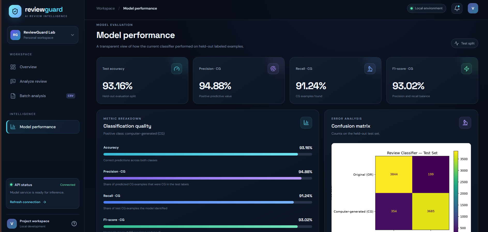

# ReviewGuard — AI Review Classification

ReviewGuard is a full-stack NLP and Machine Learning project that classifies review text as likely computer-generated (CG) or original (OR), according to the labels in its training dataset.

## Dashboard Preview




## Features

- Natural Language Processing (NLP)
- TF-IDF feature extraction with unigrams and bigrams
- Logistic Regression classification
- Single-review predictions
- Batch CSV analysis
- React-based dashboard
- FastAPI REST API
- Model evaluation using accuracy, precision, recall, F1-score and a confusion matrix

## Tech Stack

**Frontend:** React, Vite

**Backend:** Python, FastAPI, Uvicorn

**Machine Learning:** Pandas, NumPy, Scikit-learn, TF-IDF, Logistic Regression

**Visualization:** Dashboard metrics and confusion matrix

## Architecture

```text
React Frontend
      |
      | HTTP requests
      v
FastAPI Backend
      |
      v
Saved NLP + ML Pipeline
(TF-IDF + Logistic Regression)
      |
      v
CG / OR Prediction
```

## Model Performance

Results from the current held-out test split:

| Metric | Result |
|---|---:|
| Accuracy | 93.16% |
| Precision — CG | 94.88% |
| Recall — CG | 91.24% |
| F1-score — CG | 93.02% |

These are dataset-specific evaluation results, not a guarantee of performance on every real-world review.

## Project Structure

```text
ReviewGuard/
├── backend/
├── frontend/
├── src/
├── models/
├── data/
├── reports/
├── app/
├── requirements.txt
└── README.md
```

## Run Locally

### 1. Start the backend

From the project root:

```powershell
python -m pip install -r backend/requirements.txt
python -m uvicorn backend.main:app --reload --port 8000
```

Backend API documentation:

http://127.0.0.1:8000/docs

### 2. Start the frontend

Open a second terminal:

```powershell
cd frontend
npm install
npm run dev
```

Open the local URL printed by Vite, usually:

http://localhost:5173

### 3. Model and data files

The trained pipeline is stored in `models/`. Training data is not included in the repository by default; follow the project instructions to obtain the required labeled dataset.

## Limitations

The model predicts the CG and OR classes defined by its training dataset. An original review is not necessarily truthful, and a computer-generated review is not automatically fraudulent. Predictions and model scores should not be treated as proof of fraud or authenticity.

## Future Improvements

- Independent evaluation across multiple datasets
- More robust data-leakage and duplicate checks
- Comparison with other classification models
- Improved interpretability and error analysis
- Deployment with appropriate security controls

## Author

Developed as a practical NLP, Machine Learning and full-stack application project.
